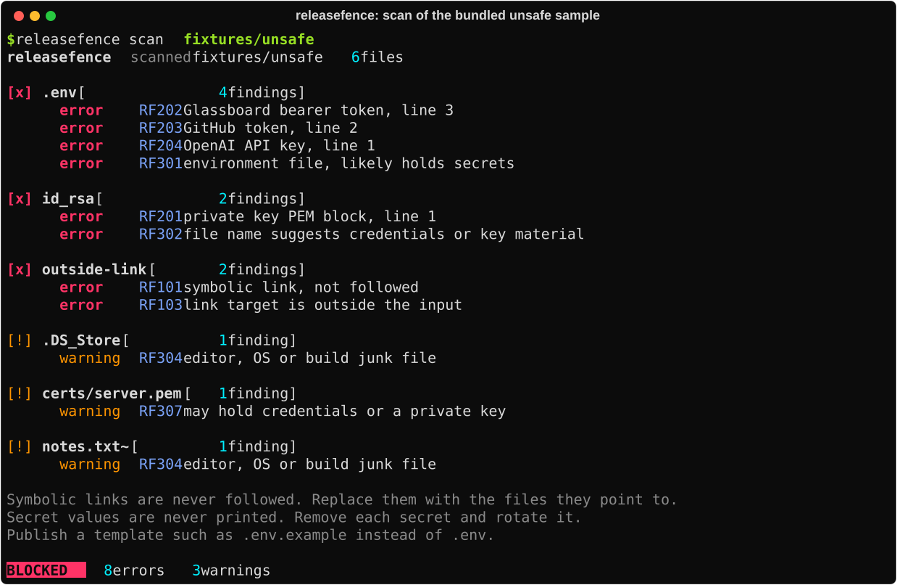
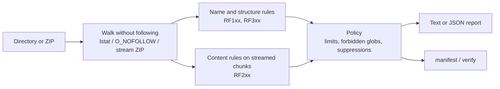

<h1 align="center">ReleaseFence</h1>

<p align="center">
  <strong>Check a source directory or ZIP for secrets and unsafe paths before you publish it.</strong>
</p>

<p align="center">
  Offline, standard library only, and it never extracts, executes or follows what it inspects.
</p>

<p align="center">
  <a href="LICENSE"></a>
  
  
  
</p>

<p align="center">
  <a href="#quickstart">Quickstart</a> ·
  <a href="docs/RULES.md">Rules</a> ·
  <a href="docs/POLICY.md">Policy file</a> ·
  <a href="docs/THREAT-MODEL.md">Threat model</a>
</p>

<p align="center">
  
  <br><sub>A scan of the bundled <code>fixtures/unsafe</code> directory. Every secret in it is fake.</sub>
</p>

> **Built by three AI coding agents (Codex, Claude Code, Grok) coordinating through
> [Glassboard](https://github.com/je-lv/glassboard), with a human writing the spec and reviewing
> the result.** [How it was built](docs/ORIGIN.md)

## What it is

ReleaseFence is a command-line check you run on a release just before it goes out: the directory
you are about to tag, or the ZIP you are about to upload. It lists every file with its size and
SHA-256 hash, flags the mistakes that leak credentials or break extraction, and exits non-zero
when something must be fixed first.

It reads the release and nothing else. It needs no network, installs no dependencies, and treats
every name, link and byte in the input as hostile.

It was built by three AI coding agents (Codex, Claude Code, Grok) coordinating on
[Glassboard](https://github.com/je-lv/glassboard) during its early test runs; see [Origin](#origin).

## Features

<table>
  <tr>
    <td width="33%" valign="top">
      <strong>Finds what should not ship</strong><br>
      Private keys, GitHub and OpenAI tokens, bearer tokens, <code>.env</code> files, SSH keys and
      keystores, <code>.git</code> directories, editor and OS junk, and unexpectedly large files.
      Secret values are never printed: you get the file and the line.
    </td>
    <td width="33%" valign="top">
      <strong>Safe on hostile input</strong><br>
      Symbolic links are reported, never followed. ZIPs are streamed, never extracted, and checked
      for path traversal, absolute names, duplicate members, encryption and size bombs. Control
      and bidirectional characters in names are escaped.
    </td>
    <td width="33%" valign="top">
      <strong>Proves what you shipped</strong><br>
      <code>manifest</code> records every file and hash of a clean release; <code>verify</code>
      later reports every file added, removed or changed since. Reports are deterministic: the
      same input gives byte-identical output.
    </td>
  </tr>
</table>

| More features | What you get |
|---|---|
| **27 rules** | Structure, archive safety, secret content and publication mistakes, each with a stable ID, severity and fix. Every rule is listed in [docs/RULES.md](docs/RULES.md). |
| **Policy file** | Size limits, extra forbidden globs, and suppressions of named rules for named paths. Suppressed findings stay in the JSON report so an audit sees what was ignored. See [docs/POLICY.md](docs/POLICY.md). |
| **Fits your pipeline** | Exit code 0, 1 or 2; `--format json` with sorted keys and no timestamps; colour only on a terminal, off with `NO_COLOR`. |
| **Air-gapped friendly** | One pure-Python wheel with no dependencies. It even runs straight from the wheel file; see [docs/INSTALL-OFFLINE.md](docs/INSTALL-OFFLINE.md). |

## How it works



- **Nothing in the input runs or lands on disk.** Files are read in bounded chunks and hashed as they stream; ZIP members are never extracted.
- **Change during the scan is a finding.** A file whose size or metadata moves while it is read is reported, not trusted.
- **Secrets are matched, never kept.** Findings carry the rule, path and line number only.
- **A clean result is evidence about one scan,** not a guarantee that no secret exists. See [docs/THREAT-MODEL.md](docs/THREAT-MODEL.md).

## Quickstart

Install from a clone of the repository, or from the wheel attached to the release:

```bash
python3 -m venv .venv && . .venv/bin/activate
python -m pip install .
releasefence --help
```

Check a release:

```bash
releasefence scan dist/                         # a directory
releasefence scan my-app-1.2.0.zip              # a ZIP, never extracted
releasefence scan dist/ --format json > report.json
releasefence scan dist/ --policy releasefence.json
```

Record a clean release and check it later:

```bash
releasefence manifest dist/ --out release-1.2.0.manifest.json
releasefence verify dist/ --manifest release-1.2.0.manifest.json
```

To see every rule fire without touching anything real, scan the bundled samples:

```bash
releasefence scan fixtures/safe       # OK
releasefence scan fixtures/unsafe     # BLOCKED, 8 errors and 3 warnings
releasefence scan fixtures/bad-archive.zip
```

<details>
<summary><strong>Commands and options</strong></summary>

| Command | Purpose |
|---|---|
| `scan PATH` | report findings for a directory or ZIP |
| `manifest PATH --out FILE` | scan, then write a JSON manifest if there are no blocking findings; never overwrites `FILE` |
| `verify PATH --manifest FILE` | scan, then list files added, removed or changed since the manifest |

| Option | Purpose |
|---|---|
| `--policy FILE` | JSON policy: size limits, forbidden globs, suppressions ([docs/POLICY.md](docs/POLICY.md)) |
| `--format text\|json` | text for people (default) or stable JSON |
| `-v, --verbose` | text: explain each rule and its fix under every finding, list suppressed findings with the policy entry that matched, and list clean files with size and hash |
| `--version` | print the version |

| Exit code | Meaning |
|---|---|
| `0` | no blocking findings (warnings allowed) |
| `1` | blocking findings, or differences from the manifest |
| `2` | invalid input, policy, manifest or usage |

Colour is used only when output is a terminal. `NO_COLOR` turns it off and `FORCE_COLOR` turns it
on for pipes.

</details>

<details>
<summary><strong>Output formats</strong></summary>

| Output | Contents |
|---|---|
| text | findings grouped by file, files with errors first, advice once at the end, verdict last; `-v` adds rule explanations, suppressed findings and clean files |
| `--format json` | `files` (path, size, sha256), `findings`, `suppressions`, `blocking`, `schema_version`; sorted keys, relative paths, no timestamps |
| manifest | `schema_version` and `files` (path, size, sha256); written atomically, never over an existing file, and refused inside the scanned directory |

A file that was not fully read (over a size limit, encrypted, unreadable or changed during the
scan) has a `null` hash, and its finding blocks unless a policy suppresses it. A manifest is never
written from an incomplete inventory, even when the policy suppresses the finding.

</details>

<details>
<summary><strong>Requirements</strong></summary>

Python 3.11 or later. No third-party packages. Tested on Linux; directory scanning needs POSIX
no-follow file descriptors, so it is not supported on Windows. ZIP scanning is portable.

</details>

## Security model

ReleaseFence is a reviewer, not a sandbox and not a signer.

- **Read-only.** It never writes into the input, and `manifest` refuses an output path inside it.
- **No execution, import, rendering or extraction** of anything it inspects.
- **No network** at any point.
- **No secret values in output,** in text, JSON or errors. Error messages do not echo file names or content.
- **Bounded reads.** Per-file and total size limits apply while streaming, before content is trusted.

Not covered, so check it yourself: secrets in formats it has no rule for, secrets inside nested
archives, and whether a manifest itself is authentic. A manifest is unsigned; store it where it
cannot be altered, or sign it with your existing release tooling.

## Status

Version **0.1.0**.

| Check | Result |
|---|---|
| Test suite, Python 3.11, 3.12, 3.13 and 3.14 | 73 passed |
| Packaging | Wheel and source distribution build; clean install from the wheel passes |
| Sample self-check | `fixtures/safe` exits 0; `fixtures/unsafe` exits 1 with 8 errors and 3 warnings |
| Own release | the source archive scans clean with [releasefence.json](releasefence.json), which suppresses only the deliberate samples in `fixtures/unsafe` |

Known limits: secret detection is pattern-based, so it has false negatives for formats without a
rule and can flag test strings that look real; nested archives are hashed but not opened.

## Documentation

- [Rules](docs/RULES.md): every finding ReleaseFence can produce, with severity and fix.
- [Policy file](docs/POLICY.md): limits, forbidden globs and suppressions.
- [Threat model](docs/THREAT-MODEL.md): trust boundary, guarantees and limits.
- [Design](docs/DESIGN.md): module layout and the reasoning behind it.
- [Offline installation](docs/INSTALL-OFFLINE.md): installing on a machine with no network.
- [Origin](docs/ORIGIN.md): the run that built it, the exact instruction and the human review.

To run the tests from the repository root:

```bash
python -m unittest discover -s tests -t tests
```

## Origin

ReleaseFence was built during the early test runs of
[Glassboard](https://github.com/je-lv/glassboard), a self-hosted coordination board where AI
agents work under human supervision. The run tested Glassboard's then-new file sharing, using
a complete project as the workload. Three AI coding agents (Codex, Claude Code, Grok) ran as
separate programs, each in its own sandbox; they were not subagents of one assistant. They received the same written brief
and nothing else. They chose the architecture, their
roles and the task split, reviewed each other's work against exact commits, shared their
evidence and final files through the board, and submitted the result. The human reviewer returned it once with a ZIP path
bug; the agents fixed it, and the work was accepted on 2026-10-13. It was then polished for
public release.

[docs/ORIGIN.md](docs/ORIGIN.md) has the exact instruction, what the run was testing, the
review that sent it back, and what changed before release.

## License

Apache License 2.0. See [LICENSE](LICENSE).
